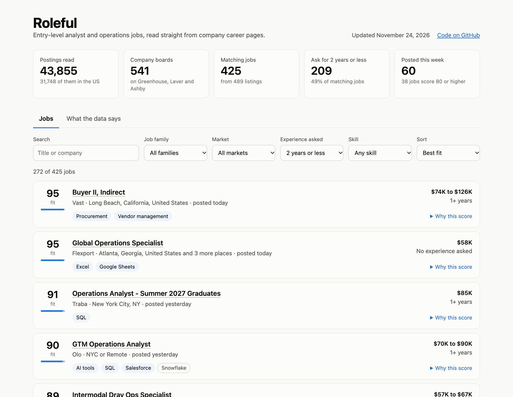
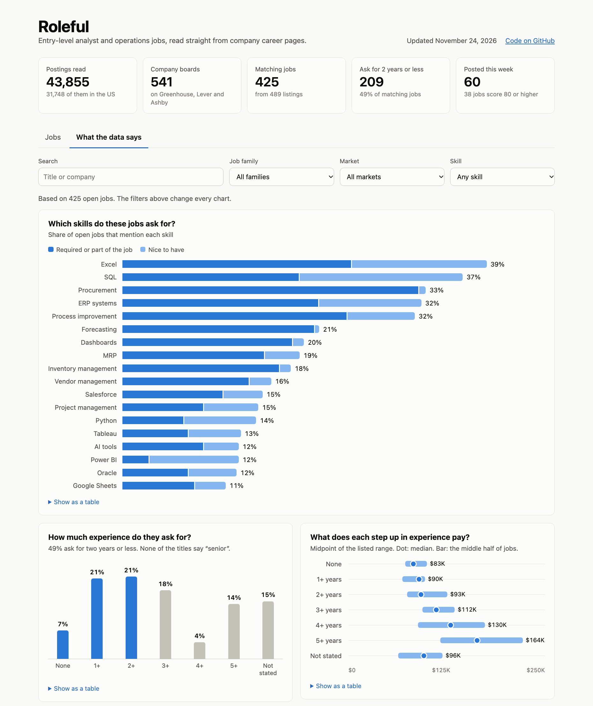
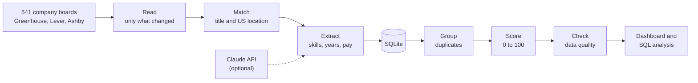

# Autonomous Job Discovery Platform (Roleful)

[](https://github.com/shahrozz1/autonomous-job-discovery-platform/actions/workflows/tests.yml)
[](https://github.com/shahrozz1/autonomous-job-discovery-platform/actions/workflows/daily.yml)

**Python · SQL (SQLite) · GitHub Actions · Claude API (optional)**

Job boards are full of reposts, ads and "entry-level" roles that want five years of experience. Roleful skips them. Every weekday it reads the career pages of 536 companies on its own, keeps the analyst and operations jobs, works out what each one really asks for, and puts the result in one searchable, scored list.

| Run of November 24, 2026 | |
|---|---:|
| Postings read | **43,855** on 541 company boards |
| In the US | 31,748 |
| Matching postings | 489, which are really **425 different jobs** |
| Ask for two years of experience or less | **209** |
| Time for the first run | 3 minutes 24 seconds |
| Time for the next run | 79 seconds (529 of 541 boards hadn't changed, so they weren't downloaded again) |



It finds and sorts jobs. It doesn't apply to anything.

---

## What the data says

Every answer below is one file in [`sql/analysis`](sql/analysis).

- **"Not senior" doesn't mean entry level.** None of these titles say senior, lead or manager, but of the 362 jobs that state a number, **42% want three or more years** ([03](sql/analysis/03_experience_bar.sql)). Operations coordinator and associate jobs are the most open: 71% of the ones that state a number take two years or less. For data analyst jobs it's 43% ([04](sql/analysis/04_experience_by_family.sql)).
- **Excel and SQL lead overall, at 39% and 37% of jobs** ([01](sql/analysis/01_skill_demand.sql)), but the answer depends on the job. SQL is in 79% of data jobs and Python in 57%. For supply chain jobs it's ERP systems at 74%, and for buying jobs it's procurement at 86% ([02](sql/analysis/02_top_skills_by_family.sql)).
- **Pay is nearly flat through two years, then climbs.** The median pay midpoint is $82,500 with no experience, $90,000 at one year and $92,500 at two, then **$111,700 at three** and $130,000 at four ([05](sql/analysis/05_pay_by_experience.sql)).
- **23% of these jobs have been up for more than three months** ([09](sql/analysis/09_posting_age.sql)). Older listings lose points in the score.
- **Pay laws show up in the data.** 97% of New York jobs and 93% of California jobs list pay. In the places outside the five target markets it's 60% ([07](sql/analysis/07_markets.sql)).



---

## How it works



1. **Read** ([`pipeline.py`](roleful/pipeline.py), [`http.py`](roleful/http.py)). One request at a time per platform, with pauses, retries and ETags, so a board that hasn't changed costs almost nothing. Descriptions are downloaded once, and only for titles that match.
2. **Match** ([`match.py`](roleful/match.py), [`places.py`](roleful/places.py)). Title rules live in [`config/profile.toml`](config/profile.toml). Locations are free text, so "US-CA-Menlo Park", "Remote (USA)" and "Pune, IN" (India, not Indiana) all have to be understood.
3. **Extract** ([`extract.py`](roleful/extract.py)). Each line is read knowing which section it's in. A skill under "Nice to have" isn't required, "401(k)" isn't pay, and "20 years in business" isn't experience.
4. **Group** ([`dedupe.py`](roleful/dedupe.py)). Companies list one job once per city, or again when it expires. Postings with the same company and core title are compared by the five-word phrases they share.
5. **Score** ([`score.py`](roleful/score.py)). Skills 35 points, experience 30, location 15, freshness 15, pay 5. Every score comes with its reasons.
6. **Check** ([`sql/checks`](sql/checks)). Nine rules, each a query that returns the rows that break it. An error fails the run.
7. **Publish** ([`daily.yml`](.github/workflows/daily.yml)). GitHub Actions runs all of this on weekday mornings and saves the dashboard. Postings that disappear are marked closed, so over time the data also shows how long jobs stay open.

## How accurate is it?

`python -m roleful evaluate` reruns these numbers.

| Check | Result |
|---|---|
| Years of experience, 100 random postings the rules had never seen | 97 right |
| The same, after fixing those three misses, on all [200 labeled postings](tests/data/years_labels.csv) | 199 right |
| Pay read from the text, compared with pay the company entered as data | same range on 142 of 147 |

**The Excel bug.** The first version of this project counted the word "excel" anywhere, so "you will excel in this role" counted as a spreadsheet skill. On this data that was 12 of 209 matches. The rule now looks at capitals, the words around it and the section it's in, and [the tests](tests/test_extract.py) keep it that way.

**The $108 job.** The data checks caught this the first time they ran. One company had entered a Material Planner's pay as $108 to $143,000, and $108 became $224,640 a year once it was read as an hourly rate. A range that runs backwards is now ignored.

## Design choices

- **Only public job feeds.** [Greenhouse](https://docs.greenhouse.io/job-board.html), [Lever](https://github.com/lever/postings-api) and [Ashby](https://developers.ashbyhq.com/docs/public-job-posting-api) publish these so postings can be read. No scraping, no logins, no LinkedIn.
- **Rules first, AI second.** The rules are free, instant, and give the same answer every time, so the numbers above can be checked. The optional AI step only fills in experience or pay the rules missed, never replaces what a company listed, stores every answer so the same text is never paid for twice, and has a cap on how much it sends.
- **A bad read never looks like a closed job.** If a board fails, or a big board suddenly comes back empty, nothing on it is marked closed.
- **Everything can be recomputed.** Facts and scores are worked out again from the stored text on every run, so a better rule fixes old data too (`python -m roleful refresh`).
- **Facts are published, descriptions aren't.** The dashboard has titles, places, pay, skills and a link to the original. The text belongs to the companies and stays in the local database.

## Run it

Needs Python 3.11 or newer.

```bash
git clone https://github.com/shahrozz1/autonomous-job-discovery-platform.git
cd autonomous-job-discovery-platform
python -m venv .venv && source .venv/bin/activate
pip install -e ".[dev]"

python -m roleful run                                              # read every board (3 to 4 minutes)
python -m roleful search "demand planning" --max-years 2           # search from the terminal
python -m roleful search sql --market "New York" --min-score 70
python -m roleful export && python -m http.server -d site 8000     # dashboard at localhost:8000
pytest                                                             # 188 tests, no network needed
```

| Command | What it does |
|---|---|
| `run` | Read every board, extract, group, score and check |
| `search` | Search open jobs by words, market, experience and score |
| `report` | Print every analysis query as a table |
| `check` | Run the data quality checks |
| `evaluate` | Measure how accurate the extraction rules are |
| `refresh` | Recompute facts and scores from stored text, no network |
| `export` | Write the dashboard's data files |
| `enrich` | Have Claude read new postings (optional: `pip install -e ".[ai]"` and an API key) |

To look for a different kind of job, edit [`config/profile.toml`](config/profile.toml). To add a company, add its board to [`config/boards.csv`](config/boards.csv). Neither needs a code change.

## Project layout

```
config/            what to look for: profile, skill patterns, company boards
roleful/           the pipeline
  sources/         one reader per job platform
sql/
  schema.sql       tables and the open_roles view
  analysis/        11 questions, one query each
  checks/          9 data quality rules
site/              the dashboard (plain HTML, CSS and JavaScript)
tests/             188 tests, made-up feeds, 200 labeled postings
.github/workflows/ tests on every push, the pipeline on weekday mornings
```

## Limits

- The list covers companies that use Greenhouse, Lever or Ashby, so it leans toward tech, consumer brands and hardware. Big employers on Workday or Taleo aren't in it, and this is not a picture of the whole job market.
- SpaceX and Anduril list many similar jobs. Together they are 28% of the open jobs, most of them in supply chain and buying.
- A skill counts as required when it's named in the requirements or in the duties. That's close to, but not the same as, a hard requirement.
- The fit score ranks jobs for a sample profile with weights I chose. It isn't a prediction of who gets hired.
- Time to close ([11](sql/analysis/11_time_to_close.sql)) needs a few weeks of runs before it says anything.

---

Built by [Shahroz Zameer](https://github.com/shahrozz1). MIT license.
